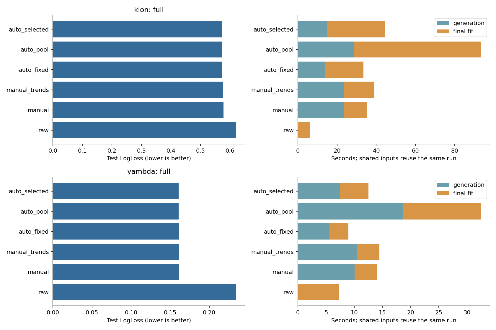

# Automated Feature Engineering for RecSys

Сравнение методов **Feature Engineering** для binary classification на KION и Yambda:
какой набор признаков дает лучший баланс качества, времени расчета и интерпретируемости
при одной модели LightGBM?

Начните с [основного notebook](FINAL_SUBMISSION/feature_engineering_comparison.ipynb).
Это самостоятельный отчет с кодом, EDA, экспериментами, таблицами, графиками и выводами.
[Подробное исследование](notebooks/00_full_research.ipynb) дополняет его HPO, feature agent,
SVD и исходными ablations. Его режим `saved` показывает ранее полученные результаты и
не называется новым обучением.

## Задача и данные

| Dataset | Использованные данные | Target |
|---|---|---|
| KION | 1 594 519 пригодных user–item агрегатов после исключения 268 строк без target | reported watched_pct ≥ 50 |
| Yambda | 989 232 likes/dislikes из flat/50m, с artist/album mappings | like против dislike среди явных реакций |

Это conditional scoring наблюдаемых событий. Ни CTR по всем показам, ни full-catalog
retrieval здесь не оцениваются. Полный Yambda-50M/5B не использован.
Источники: [KION](https://github.com/irsafilo/KION_DATASET),
[Yambda](https://huggingface.co/datasets/yandex/yambda).
Raw data не включены в Git; notebook загружает pinned revisions и проверяет SHA256.
Условия использования данных задаются их источниками; MIT LICENSE репозитория относится к коду.

## Подход и честное сравнение

Сравниваются raw IDs/metadata, manual temporal aggregates, manual + trends,
automated fixed windows, полный automated pool и validation feature selection.
Все методы внутри dataset используют одинаковые строки, target, seed=42 и параметры
LightGBM. Параметры взяты из существующего manual HPO; нового HPO в кратком сравнении нет.
Цена дополнительных fits автоматического поиска учитывается отдельно.

Разбиение глобальное по времени: примерно 70% train, 7.5% search validation,
7.5% audit validation, 15% test. Равные timestamps не пересекают границы.
Исторические признаки используют только события `<T`, encoder и pruning fit-ятся
на train. Search выбирает набор/число деревьев, audit/test этот выбор не меняют.
После lock финальные модели fit-ятся на первых 85% с фиксированным числом деревьев.

Основной критерий — LogLoss; дополнительно ROC-AUC и average precision.
Вспомогательные NDCG/Recall/MAP подробного исследования — proxy среди наблюдаемых
user×timestamp групп, не official retrieval benchmark. SVD имеет отдельные matched
warmup controls и не смешивается с основной таблицей.

## Воспроизведение

Проверено на Python 3.13, macOS arm64. Зависимости закреплены.

```bash
git clone https://github.com/abdrsan/automated-feature-engineering-recsys.git
cd automated-feature-engineering-recsys
python3 -m venv .venv
source .venv/bin/activate
python -m pip install -r requirements-notebooks.txt
python -m pytest -q
```

Откройте `FINAL_SUBMISSION/feature_engineering_comparison.ipynb` в Jupyter или VS Code
и выполните **Restart Kernel → Run All**. Первая code cell проверяет версии и устанавливает
недостающие пакеты через `%pip` в окружение текущего kernel. При необходимости frontend
Jupyter можно установить отдельно; сам notebook не импортирует проектные модули.

- `MODE="full"` по умолчанию: все пригодные строки обоих источников.
- `MODE="demo"`: полный pipeline на первых 100k событий; его метрики не заменяют full.
- `DATASETS=["kion"]` или `["yambda"]`: один источник.
- `FE_RAW_DIR`: необязательный путь к уже скачанным папкам `kion/`, `yambda/`.

Каждый запуск создает отдельный ignored `.runs/` с boosters, predictions, CSV,
protocol lock, costs и SHA256. Full на CPU может занимать десятки минут и требует
существенно больше памяти, чем demo. Raw files автоматически загружаются при отсутствии.
После обновления уже загруженной библиотеки перезапустите kernel перед Run All.

Для полного исходного исследования с 20 HPO trials и тремя seeds:

```bash
export POLARS_MAX_THREADS=4
export OPENBLAS_NUM_THREADS=4
export OMP_NUM_THREADS=4
python -m scripts.download_datasets --dataset both
python -m scripts.run_study --dataset kion --stage all --output artifacts/kion_replication
python -m scripts.run_study --dataset yambda --stage all --output artifacts/yambda_replication
```

Это отдельная, более дорогая репликация исходного pipeline. Большие caches и boosters заново создаются локально и не включены в GitHub.
Predictions нового полного сравнения опубликованы в `results/full/`. Сводные исходные
ledgers/specs/plots сохранены в `artifacts/kion/` и `artifacts/yambda/`.

## Проверенные результаты

Полный новый controlled run, seed42; параметры одинаковы внутри dataset.

| dataset | method | inputs | logloss | auc | average_precision | generation_seconds | fit_seconds |
|---|---|---|---|---|---|---|---|
| kion | raw | 16 | 0.619689 | 0.676487 | 0.513175 | 0.014441 | 6.006823 |
| kion | manual | 106 | 0.577836 | 0.726984 | 0.586076 | 23.497935 | 11.967805 |
| kion | manual_trends | 118 | 0.577493 | 0.727001 | 0.585852 | 23.582419 | 15.452567 |
| kion | auto_fixed | 80 | 0.573697 | 0.730223 | 0.590820 | 13.984350 | 19.547052 |
| kion | auto_pool | 509 | 0.572512 | 0.731281 | 0.591844 | 28.714919 | 64.558537 |
| kion | auto_selected | 144 | 0.572429 | 0.731613 | 0.591841 | 14.748581 | 29.766906 |
| yambda | raw | 5 | 0.234020 | 0.833212 | 0.976265 | 0.005182 | 7.330630 |
| yambda | manual | 80 | 0.161425 | 0.936561 | 0.991667 | 10.036127 | 4.048885 |
| yambda | manual_trends | 92 | 0.161747 | 0.936464 | 0.991652 | 10.412020 | 4.061994 |
| yambda | auto_fixed | 37 | 0.161770 | 0.936351 | 0.991617 | 5.603622 | 3.351379 |
| yambda | auto_pool | 447 | 0.160768 | 0.937150 | 0.991775 | 18.591662 | 13.831724 |
| yambda | auto_selected | 69 | 0.160820 | 0.936956 | 0.991717 | 7.445228 | 5.089535 |

На KION observed test winner — auto selected (144 inputs), на Yambda — полный auto pool (447 inputs). Selected Yambda использует 69 inputs при очень близком качестве. Manual trends немного помогли KION и ухудшили Yambda. Выигрыш большого pool не означает, что каждое выбранное окно необходимо.

Generation time относится только к historical features; common encoder рассчитывается отдельно. Fit time не включает search/prediction/metrics. Дополнительные search fits сохранены в CSV; это не одинаковый общий compute budget. Matrix MiB и RSS находятся в полной таблице. CPU общего desktop не изолирован.



[Таблица CSV](results/full/comparison.csv), [анализ признаков](results/full/feature_analysis.png), [актуальный аудит](AUDIT_PUBLICATION.md).

Проверки: **94 tests PASS**, основной notebook **21/21** code cells в full mode, дополнительный **47/47** в saved mode. Для нового сравнения независимо воспроизведены predictions 12 boosters и 36 classification metrics; core features и split проверены synthetic leakage tests. Строгий event-time cutoff проверен; production availability остается допущением.

```bash
python -m scripts.verify_published_results
```

Эта команда без переобучения проверяет опубликованные predictions, метрики, SHA256 и выполнение ячеек. Полный booster replay требует заново созданных локальных моделей; до публикации он выполнен. `original_run_sha256.json` сохраняет hashes полного локального run; большие boosters в GitHub не включены.

## Ограничения выводов

Test уже наблюдался до аудита: результаты являются **post-audit re-evaluation**,
а не новым слепым подтверждением. Один temporal split и seed краткого сравнения
не оценивают устойчивость всей search procedure; три seeds старого исследования
относятся к его фиксированным selections. Production `available_at` и исторические
версии metadata отсутствуют. В KION 180d эквивалентно all-history, user–item пары не
повторяются. Feature gain при коррелирующих окнах не является причинной важностью.

Подробные постановки, исходные результаты и ограничения: [REPORT.md](REPORT.md),
[обзор подходов](RESEARCH.md), [соответствие исходному ТЗ](TASK_CHECKLIST.md).
