> Исторический документ исходного исследования. Текущее сравнение методов и статус публикации — в [README](README.md) и [основном notebook](FINAL_SUBMISSION/feature_engineering_comparison.ipynb). Старые и новые эксперименты используют разные правила выбора наборов и не подменяют друг друга.

# Automated Temporal Feature Search: KION и Yambda

## Problem, motivation и research question

Можно ли уменьшить ручной выбор temporal features, задав bounded grammar
`entity × event × aggregation × window`, и сохранить или улучшить сильный LightGBM baseline?
Проверяем это на двух реальных датасетах, указанных пользователем. MovieLens больше не
является основным результатом; прежний отчет сохранен в REPORT_MOVIELENS.md.
Текущее состояние — **post-audit re-evaluation**. Исходные runs и notebook сохранены
в artifacts/pre_audit. Test уже наблюдался до исправлений; новый run не является
слепым независимым подтверждением. Структуры и параметры повторно выбирались только
на search validation по заранее описанным исправленным правилам.

## Источники, постановка и границы выводов

- [KION official repository](https://github.com/irsafilo/KION_DATASET): скачанный interactions.csv.zip содержит **1 594 787** строк за 2021-03-13—2021-08-22, хотя README описывает больший размер и другой конечный год. 268 строк с отсутствующим watched_pct не получают label и исключены; основной run использует все **1 594 519** оставшихся строк без user sampling. Это агрегированные user–item записи с last_watch_dt; target — reported доля просмотра >=50%, условно на наблюдаемой паре и дате последнего просмотра. Это не оценка качества рекомендаций до первого просмотра и не воспроизведение официального KION contest.
- [Yambda official dataset](https://huggingface.co/datasets/yandex/yambda): берутся все likes/dislikes из flat/50m и artist/album mappings. **989 232** явных реакции, а не весь Yambda-50M и не Yambda-5B. Like/dislike — наблюдаемые положительные/отрицательные действия, но classifier оценивает знак реакции условно на ее наличии; negatives из ненаблюдаемых пар не придумываются. Listen/unlike/undislike контекст не включен; event counts не являются состоянием текущего like после отмены.
- [Yambda paper](https://arxiv.org/html/2505.22238v1): формула времени `floor((T−T0)/5)*5` означает относительные **секунды**, уже округленные до 5s. Умножение timestamp еще на пять ошибочно. Epoch 1970 — только внутренняя координата. Calendar hour/weekday отключены. Альбом и исполнитель сведены к minimum metadata ID; это детерминированное упрощение многозначной связи, исключающее размножение строк.

Два разных target не позволяют напрямую объявить один датасет «легче» по AUC или
сравнивать абсолютный LogLoss между ними. Сравниваются relative manual/auto изменения
внутри каждого dataset. Ranking ниже — proxy по user × timestamp с >=2 различными item
и mixed labels; группы с повторением одного item исключены целиком. Это не full-catalog
recall. Для KION это день, для Yambda — 5s bin. Итоговый ranking audit пересчитывает
только proxy metrics по сохраненным моделям; AUC, LogLoss и выбор моделей не меняются.
Если eligible groups отсутствуют, ranking metrics сохраняются как NaN/—, а не выдумываются.

## Related approaches и выбор метода

DFS/Featuretools дают relational primitives, generic AutoFE и RL/NFS исследуют generation,
AutoFIS/AutoField — interactions/fields, Optuna — параметрический search. Их отличие от
нашей постановки и стоимость GNN, MF, sequential Transformers, FT-Transformer/TabPFN
разобраны с первичными источниками и сравнительной таблицей в [RESEARCH.md](RESEARCH.md).
Здесь выбор остается hybrid temporal factory: она отвечает именно на вопрос windows,
интерпретируема и проверяема на CPU. Сложные модели не обучаются ради названия.

## Validation, leakage prevention и strong baseline

Global temporal split: около 70% train, 7.5% search validation, 7.5% audit validation,
15% test; равные timestamps не пересекают границы. Категориальный encoder и pruning
fit-ятся только на train. Search validation выбирает features/windows/HPO, audit/test
не меняют lock. Затем final модели refit-ятся на первых 85% с числом деревьев,
выбранным на search; manual/automatic проверяются на трех seeds [42,2024,7].

Feature engine использует только `[T−W,T)` или all-history `<T`. Для KION исключается
**весь текущий день**; для Yambda — весь текущий 5s bin. Текущие history_value/watched_pct/
total_dur/label/event не являются base inputs. Polars rolling closed=left; cumulative
агрегаты предварительно объединяют timestamp ties. Source timestamp audit и cardinality
join checks дополняются independent naive oracle, prefix invariance, current/future
mutation tests и тестами реальных dataset schemas и единиц времени.

Online replay допускает использование outcomes предыдущих времен внутри validation/test.
Для KION это явное offline допущение: reported aggregate доступен после last_watch_day;
доступность в production и timestamps сессий в файле не задокументированы достаточно,
поэтому такая схема не доказывает возможность scoring до начала просмотра. Static
metadata считаются заранее известными; нужны versioned joins для production.

Manual baseline содержит IDs и доступные static categories; user/item/user-item/user-category/
user-author counts, recency, positive-event rates, historical watched_pct means в KION;
окна 7/30 days/all history. После независимого аудита reference выбирается среди всех
выполненных manual ablation stages по search LogLoss, а не только двух полных наборов.
Pool и выбранный source фиксируются до audit/test. Это не exhaustive search всех
подмножеств ручных families. Параметры HPO первоначально настроены на полном manual,
после чего все manual stages сравниваются с одними и теми же параметрами.
Каждая manual и auto модель получает 20 Optuna trials (300k sampled fit rows с полной
историей, затем full-train re-fit). Никакого random train/test split нет.

## Automated generation, selection и feature agent

FeatureSpec валидирует allowlisted entities/events/aggregations/windows. Поддержаны count,
sum/mean/min/max, nunique, recency, event_rate/conversion/frequency и short/long trends.
Actual window grid: 1,3,7,14,21,30,60,90,180 days и all_history. Есть global, user, item,
user-item, category/album, user-category/album, author/director/artist, user-author,
item-gender где доступно. Fixed-window control использует только 7/30/all.

Train pruning удаляет constants, sparse/missing, duplicates и near-correlated features.
Gain предлагает top32/64/96/128 наборы; re-fit по validation выбирает размер и окна.
При разнице loss <=0.0001 предпочитается меньший набор. Shared-window control ограничивает
все families общими тремя окнами. Agent делает две bounded группы новых соседних окон;
KEEP при улучшении validation LogLoss >=0.0001. Отрицательные результаты сохраняются.
Optional LLM hook возвращает только validated FeatureSpecs; arbitrary SQL не исполняется.

## Сводка реальных final test результатов

| Dataset | Rows | Manual mean LogLoss | Auto mean LogLoss | Δ auto−manual | Manual mean AUC | Auto mean AUC | Selected specs |
| --- | --- | --- | --- | --- | --- | --- | --- |
| kion | 1594519 | 0.577981 | 0.572533 | -0.005448 | 0.726552 | 0.730904 | 493 |
| yambda | 989232 | 0.163072 | 0.161150 | -0.001921 | 0.936045 | 0.936790 | 32 |

Post-audit stability check: Yambda manual, лучший среди stages на search, имеет test LogLoss 0.163072; прежний полный manual — 0.161658. Это ухудшение показывает нестабильность validation выбора; reference не менялся после test. Поэтому новую величину auto gain нельзя трактовать как чистый эффект исправления. Исходные результаты сохранены в artifacts/pre_audit; before/after comparison — в FIXES.md.

## KION

### Данные и target

Фактический размер после нормализации: **1,594,519 строк**, **567,555 users**, **12,639 items**. Дубликаты по user/item/time/label: 0; повторные user–item строки: 0.

Target: `reported watched_pct >= 50 among observed aggregate watches`. Events: ['watch_high', 'watch_low']. Cohort: user_id % 1 == 0; all valid-target records; no temporal row truncation.

Время: last_watch_dt at day precision; exclude entire target day. category_id: first listed genre; author: first listed director.

| Column | Type | Missing |
| --- | --- | --- |
| row_id | UInt32 | 0 |
| user_id | Int64 | 0 |
| item_id | Int64 | 0 |
| age | String | 0 |
| income | String | 0 |
| gender | String | 0 |
| kids_flg | Int64 | 305733 |
| content_type | String | 0 |
| release_year | Float64 | 95 |
| genres | String | 0 |
| countries | String | 0 |
| for_kids | Float64 | 1559028 |
| age_rating | Float64 | 3 |
| category_id | String | 0 |
| author | String | 0 |
| timestamp | Datetime(time_unit='us', time_zone=None) | 0 |
| label | Int8 | 0 |
| event | String | 0 |
| history_value | Float64 | 0 |
| time_is_relative | Boolean | 0 |

### Temporal split

| Part | Rows | Start coordinate | End coordinate | Positive rate (test hidden during EDA) |
| --- | --- | --- | --- | --- |
| train | 1103170 | 2021-03-13 00:00:00 | 2021-07-23 00:00:00 | 0.472883 |
| validation_search | 121125 | 2021-07-24 00:00:00 | 2021-07-31 00:00:00 | 0.382423 |
| validation_audit | 129777 | 2021-08-01 00:00:00 | 2021-08-08 00:00:00 | 0.374974 |
| test | 240447 | 2021-08-09 00:00:00 | 2021-08-22 00:00:00 | — |

### Baseline, ablation и поиск на validation

Manual: **manual_plus_trend**; automatic: **auto_adaptive_all**. HPO: 20 trials для каждого. Candidate specs: 621; после train pruning: 493; selected: 493. Base inputs не входят в selected count.

Completed/attempts HPO: {'manual': {'completed': 20, 'attempts': 20}, 'auto': {'completed': 20, 'attempts': 20}}. Прерванные попытки сохраняются в tuning CSV; budget считает только COMPLETE, чтобы возобновление не сокращало число оцененных конфигураций.

| Model/experiment | Inputs | LogLoss ↓ | AUC ↑ | proxy NDCG@5 | proxy NDCG@10 | proxy Recall@10 | Proxy groups |
| --- | --- | --- | --- | --- | --- | --- | --- |
| base_default | 16 | 0.626820 | 0.681708 | 0.869499 | 0.870491 | 1.000000 | 6297 |
| base_categorical | 16 | 0.627647 | 0.680565 | 0.868607 | 0.869688 | 1.000000 | 6297 |
| plus_user_temporal | 31 | 0.616375 | 0.705503 | 0.872646 | 0.873605 | 1.000000 | 6297 |
| plus_item_temporal | 46 | 0.606967 | 0.713505 | 0.873571 | 0.874598 | 1.000000 | 6297 |
| plus_user_item | 61 | 0.606967 | 0.713505 | 0.873571 | 0.874598 | 1.000000 | 6297 |
| plus_user_category | 76 | 0.607201 | 0.713923 | 0.872190 | 0.873136 | 1.000000 | 6297 |
| plus_metadata_relations | 91 | 0.607418 | 0.713042 | 0.871491 | 0.872498 | 1.000000 | 6297 |
| manual | 106 | 0.604214 | 0.714959 | 0.873202 | 0.874254 | 1.000000 | 6297 |
| manual_plus_trend | 118 | 0.603705 | 0.714971 | 0.872827 | 0.873806 | 1.000000 | 6297 |
| auto_fixed_windows_all | 206 | 0.590850 | 0.715653 | 0.872127 | 0.873042 | 1.000000 | 6297 |
| auto_fixed_windows_top32 | 48 | 0.590927 | 0.715199 | 0.871713 | 0.872701 | 0.999960 | 6297 |
| auto_fixed_windows_top64 | 80 | 0.590014 | 0.716359 | 0.872126 | 0.873041 | 0.999960 | 6297 |
| auto_fixed_windows_top96 | 112 | 0.590076 | 0.715765 | 0.872206 | 0.873220 | 0.999960 | 6297 |
| auto_fixed_windows_top128 | 144 | 0.590321 | 0.715560 | 0.872296 | 0.873240 | 1.000000 | 6297 |
| auto_adaptive_all | 509 | 0.589198 | 0.716660 | 0.872086 | 0.872975 | 0.999960 | 6297 |
| auto_adaptive_top32 | 48 | 0.589638 | 0.715855 | 0.872973 | 0.873913 | 0.999960 | 6297 |
| auto_adaptive_top64 | 80 | 0.589655 | 0.715917 | 0.871290 | 0.872182 | 1.000000 | 6297 |
| auto_adaptive_top96 | 112 | 0.589731 | 0.716114 | 0.871342 | 0.872163 | 1.000000 | 6297 |
| auto_adaptive_top128 | 144 | 0.589385 | 0.716528 | 0.870815 | 0.871601 | 0.999960 | 6297 |
| shared_windows_pool | 224 | 0.592121 | 0.714335 | 0.872765 | 0.873684 | 0.999960 | 6297 |
| shared_windows_control | 224 | 0.589959 | 0.716320 | 0.872323 | 0.873242 | 0.999960 | 6297 |
| auto_tuned | 509 | 0.589405 | 0.716877 | 0.871122 | 0.871956 | 0.999960 | 6297 |
| agent_round_1 | 517 | 0.589265 | 0.716427 | 0.871492 | 0.872352 | 0.999960 | 6297 |
| agent_round_2 | 517 | 0.589227 | 0.716895 | 0.871253 | 0.872096 | 1.000000 | 6297 |
| manual_warmup_control | 118 | 0.603552 | 0.714852 | 0.872336 | 0.873248 | 1.000000 | 6297 |
| auto_warmup_control | 509 | 0.589685 | 0.716131 | 0.871565 | 0.872420 | 1.000000 | 6297 |
| auto_plus_svd | 513 | 0.589900 | 0.715970 | 0.870644 | 0.871556 | 0.999960 | 6297 |

В последовательной ablation rates добавляются после metadata relations. Все ablation arms используют одни manual tuned параметры; вклад группы условен на уже добавленных предыдущих группах. Fixed/shared controls сначала ограничивают допустимый pool, затем независимо выполняют train pruning и fit; shared ranking использует gain собственного pool. Controls меняют состав и размер набора; это не чистый причинный эффект одного окна.

### Audit и финальный test

| Model/experiment | Inputs | LogLoss ↓ | AUC ↑ | proxy NDCG@5 | proxy NDCG@10 | proxy Recall@10 | Proxy groups |
| --- | --- | --- | --- | --- | --- | --- | --- |
| categorical | 16 | 0.638703 | 0.666643 | 0.863141 | 0.863618 | 1.000000 | 6637 |
| manual | 118 | 0.603246 | 0.712648 | 0.869875 | 0.870365 | 1.000000 | 6637 |
| automatic | 509 | 0.589466 | 0.714127 | 0.867706 | 0.868279 | 1.000000 | 6637 |
| manual_warmup | 118 | 0.602726 | 0.712566 | 0.869783 | 0.870299 | 1.000000 | 6637 |
| auto_warmup | 509 | 0.589880 | 0.714190 | 0.867613 | 0.868324 | 1.000000 | 6637 |
| auto_plus_svd | 513 | 0.589615 | 0.714355 | 0.868942 | 0.869554 | 1.000000 | 6637 |
| auto_fixed_windows_top64 | 80 | 0.590241 | 0.713745 | 0.866643 | 0.867226 | 1.000000 | 6637 |
| auto_adaptive_all | 509 | 0.589466 | 0.714127 | 0.867706 | 0.868279 | 1.000000 | 6637 |
| shared_windows_control | 224 | 0.591415 | 0.712657 | 0.868769 | 0.869273 | 1.000000 | 6637 |

| Model/experiment | Inputs | LogLoss ↓ | AUC ↑ | proxy NDCG@5 | proxy NDCG@10 | proxy Recall@10 | Proxy groups |
| --- | --- | --- | --- | --- | --- | --- | --- |
| categorical | 16 | 0.619689 | 0.676487 | 0.866583 | 0.867477 | 0.999876 | 12332 |
| manual | 118 | 0.577493 | 0.727001 | 0.871395 | 0.872146 | 0.999849 | 12332 |
| automatic | 509 | 0.572327 | 0.731462 | 0.873661 | 0.874469 | 0.999876 | 12332 |
| manual_warmup | 118 | 0.578137 | 0.726888 | 0.871812 | 0.872542 | 0.999822 | 12332 |
| auto_warmup | 509 | 0.572847 | 0.730356 | 0.872964 | 0.873770 | 0.999849 | 12332 |
| auto_plus_svd | 513 | 0.573067 | 0.730918 | 0.872883 | 0.873759 | 0.999849 | 12332 |

Среднее/SD на test между заранее заданными seeds (SVD arms — один seed):

| Model | Seeds | Mean LogLoss | SD LogLoss | Mean AUC | SD AUC |
| --- | --- | --- | --- | --- | --- |
| auto_plus_svd | 1 | 0.573067 | — | 0.730918 | — |
| auto_warmup | 1 | 0.572847 | — | 0.730356 | — |
| automatic | 3 | 0.572533 | 0.000238 | 0.730904 | 0.000486 |
| categorical | 1 | 0.619689 | — | 0.676487 | — |
| manual | 3 | 0.577981 | 0.000423 | 0.726552 | 0.000435 |
| manual_warmup | 1 | 0.578137 | — | 0.726888 | — |

Automatic − manual: mean ΔLogLoss **-0.005448**; paired ΔLogLoss seed 42 **-0.005166**, 95% user-cluster CI **[-0.005596, -0.004767]**. ΔAUC seed 42 +0.004461. Bootstrap 300 repeats, фиксированные модели. Неопределенность всей процедуры search этим CI не покрывается.

**Автоматический набор улучшил LogLoss на этом test: среднее по seeds меньше, а paired CI для заранее выбранного seed 42 ниже нуля.**

### Selected temporal windows

| Entity | Selected specs | Windows including trend dependencies |
| --- | --- | --- |
| author | 64 | 1d, 3d, 7d, 14d, 21d, 30d, 60d, 90d, 180d, all_history |
| category | 62 | 1d, 3d, 7d, 14d, 21d, 30d, 60d, 90d, 180d, all_history |
| global | 59 | 1d, 3d, 7d, 14d, 21d, 30d, 60d, 90d, 180d, all_history |
| item | 62 | 1d, 3d, 7d, 14d, 21d, 30d, 60d, 90d, all_history |
| item_gender | 61 | 1d, 3d, 7d, 14d, 21d, 30d, 60d, 90d, 180d, all_history |
| user | 62 | 1d, 3d, 7d, 14d, 21d, 30d, 60d, 90d, all_history |
| user_author | 61 | 1d, 3d, 7d, 14d, 21d, 30d, 60d, 90d, all_history |
| user_category | 62 | 1d, 3d, 7d, 14d, 21d, 30d, 60d, 90d, all_history |

Explicit trend specs в выбранном наборе: 84. Наличие разных окон не доказывает их необходимость; сравнение shared_windows_control на audit важнее одного heatmap.

### Feature agent и pruning

| Round | Before | After | KEEP | Generation s |
| --- | --- | --- | --- | --- |
| 1 | 0.589198 | 0.589265 | False | 1.556345 |
| 2 | 0.589198 | 0.589227 | False | 1.687502 |

Pruning log содержит 128 удалений. Все proposals и причины сохранены отдельно; rejected proposals не включаются в locked набор.

### Feature importance

| Feature | Train gain | Family |
| --- | --- | --- |
| item__watch_high__event_rate__30d__all | 329347.506519 | item |
| item__watch_high__event_rate__21d__all | 301001.617500 | item |
| item__watch_high__event_rate__all__all | 227326.913696 | item |
| item_id | 161660.220051 | base |
| author | 154509.965363 | base |
| user_id | 127790.388443 | base |
| user__all__mean__90d__history_value | 92228.039425 | user |
| user__all__mean__all__history_value | 90834.562744 | user |
| author__watch_high__event_rate__7d__all | 78791.028748 | author |
| item__watch_high__event_rate__90d__all | 37021.398811 | item |
| genres | 36866.020386 | base |
| item_gender__watch_high__event_rate__180d__all | 30631.322937 | item_gender |
| item__watch_high__event_rate__7d__all | 29929.371960 | item |
| user__watch_high__event_rate__all__all | 24718.123383 | user |
| author__watch_high__event_rate__21d__all | 24477.099609 | author |
| user__all__mean__60d__history_value | 21136.405167 | user |
| author__watch_high__event_rate__3d__all | 20664.333923 | author |
| item__all__mean__all__history_value | 17742.760483 | item |
| author__watch_high__event_rate__30d__all | 16969.890137 | author |
| item__watch_high__event_rate__1d__all | 15681.665504 | item |

Gain — train-only proposal signal со смещением при корреляции; не причинная importance. SHAP и permutation importance не вычислялись, такие результаты не заявляются.

В KION весь наблюдаемый период короче 180 дней. Поэтому 180d здесь эквивалентно all-history; pruning может оставить только один из этих aliases. Выбранное 180d не доказывает оптимальность именно 180 дней. User–item пары не повторяются, и их исторические счетчики постоянны; эта семья удаляется автоматически.

### Learned representations

SVD basis fit-ится на первых 10% событий. Их строки исключены одинаково в manual_warmup/auto_warmup/auto_plus_svd. User profile — mean signed item vectors по строгому прошлому. Unknown basis items имеют нулевой vector. Этот эксперимент не использует будущие train edges.

SVD − auto_warmup ΔLogLoss **+0.000220**, CI **[+0.000055, +0.000385]**; ΔAUC +0.000563. Один seed; conditional CI. Manual+SVD не обучался, весь возможный выигрыш hybrid нельзя приписать именно auto search.

### Ответы на исследовательские вопросы

Manual multi-scale trends меняют search LogLoss на -0.000508; это небольшой условный эффект, а не универсальная польза ratios. Итоговый automatic набор содержит 84 explicit trend specs.

Начальный pruning: 621 → 493. Всего исследовано 637 specs с учетом agent proposals, в финале 493, на 22.6% меньше total explored. До HPO/agent выбранный adaptive budget против adaptive_all дает Δ search LogLoss +0.000000 при одинаковых initial parameters. Curve по budgets показывает фактическую зависимость качества от числа inputs; компактный оптимум заранее не предполагается.

Adaptive_all − fixed-window pool: Δ search LogLoss -0.001653; отрицательная разница означает преимущество adaptive в этом сравнении. На audit выбранный adaptive набор − shared-window control: Δ LogLoss -0.001949. Знак результата сохранен; более гибкое пространство не обязано выигрывать. Состав features и процедура отбора тоже различаются; отдельный причинный эффект индивидуальных окон не изолирован.

Расчет manual плюс всех дополнительных кандидатов занимает примерно 2.62× manual generation. Это только feature computation, без дополнительных fitting/search rounds. Итоговый serving использует выбранные specs, а не весь исследованный pool.

Человек перестал выбирать каждую конкретную колонку и окно; он по-прежнему задает target, допустимые отношения, primitives, temporal protocol и budget. Agent принял 0 из 2 групп по search threshold. Автоматизация процесса и доказанный вклад каждой его стадии — разные утверждения.

### Вычислительная стоимость

Измеренная сумма fit time стадии manual (seed42 ablations + HPO): **351.9 s**; дополнительной auto search стадии (pool/budget/agent/shared fits + HPO): **1949.8 s**, **5.54×** manual стадии сверх нее. HPO отдельно: manual 134.6 s, auto 807.8 s. Здесь нет prediction/metrics overhead, feature generation, representations, дополнительных seeds и final refits; это не elapsed wall time.

Manual + manual trends generation: **22.012 s**, matrix 536.9 MiB; дополнительные auto candidates: **35.718 s**, matrix 2702.9 MiB. Final selected features на всех строках: 92.527 s.

| Experiment | Inputs | Fit s | Peak process MiB |
| --- | --- | --- | --- |
| base_default | 16 | 17.295649 | 2288.093750 |
| base_categorical | 16 | 16.557760 | 1813.281250 |
| plus_user_temporal | 31 | 18.991048 | 1909.437500 |
| plus_item_temporal | 46 | 22.703544 | 2206.750000 |
| plus_user_item | 61 | 23.921175 | 2142.718750 |
| plus_user_category | 76 | 33.708595 | 2154.984375 |
| plus_metadata_relations | 91 | 31.899032 | 2620.765625 |
| manual | 106 | 22.694256 | 3197.843750 |
| manual_plus_trend | 118 | 29.472050 | 3428.781250 |
| auto_fixed_windows_all | 206 | 61.680672 | 4940.953125 |
| auto_fixed_windows_top32 | 48 | 23.403377 | 3502.296875 |
| auto_fixed_windows_top64 | 80 | 35.833968 | 2760.609375 |
| auto_fixed_windows_top96 | 112 | 51.552616 | 3123.750000 |
| auto_fixed_windows_top128 | 144 | 58.764689 | 3125.765625 |
| auto_adaptive_all | 509 | 146.570982 | 7083.796875 |
| auto_adaptive_top32 | 48 | 30.706861 | 1943.625000 |
| auto_adaptive_top64 | 80 | 44.395472 | 2243.687500 |
| auto_adaptive_top96 | 112 | 49.555473 | 3047.906250 |
| auto_adaptive_top128 | 144 | 65.751604 | 3288.703125 |
| shared_windows_pool | 224 | 55.606397 | 3981.812500 |
| shared_windows_control | 224 | 72.536725 | 3752.156250 |
| auto_tuned | 509 | 214.556743 | 6448.000000 |
| agent_round_1 | 517 | 116.241731 | 7996.562500 |
| agent_round_2 | 517 | 114.876297 | 7081.312500 |
| manual_warmup_control | 118 | 19.110485 | 3328.250000 |
| auto_warmup_control | 509 | 93.372345 | 8380.140625 |
| auto_plus_svd | 513 | 70.795463 | 5078.781250 |

RSS — peak процесса с удерживаемыми матрицами. Generation=0/cache_hit=True означает reuse, но cache_hit в model rows не является точной трассировкой происхождения каждого block. Профили cache сохраняют измеренное время создания matrix; в повторном KION оно относится к предыдущему вычислению с тем же engine/data/spec hash. HPO time хранится отдельно в tuning CSV; указанные fit times не являются end-to-end latency.

Post-lock diagnostics: known/unknown IDs и organic/recommendation-driven, где доступны. Они не используются для смены модели.

| Model | Segment | Rows | LogLoss | AUC |
| --- | --- | --- | --- | --- |
| categorical | known_user_id | 129632 | 0.627186 | 0.679332 |
| categorical | unknown_user_id | 110815 | 0.610919 | 0.675850 |
| manual | known_user_id | 129632 | 0.588495 | 0.733349 |
| manual | unknown_user_id | 110815 | 0.564624 | 0.712009 |
| automatic | known_user_id | 129632 | 0.583218 | 0.738127 |
| automatic | unknown_user_id | 110815 | 0.559587 | 0.716587 |
| manual_warmup | known_user_id | 129632 | 0.589213 | 0.732754 |
| manual_warmup | unknown_user_id | 110815 | 0.565179 | 0.712590 |
| auto_warmup | known_user_id | 129632 | 0.583955 | 0.736578 |
| auto_warmup | unknown_user_id | 110815 | 0.559853 | 0.716060 |
| auto_plus_svd | known_user_id | 129632 | 0.584321 | 0.737138 |
| auto_plus_svd | unknown_user_id | 110815 | 0.559901 | 0.716690 |

### Графики

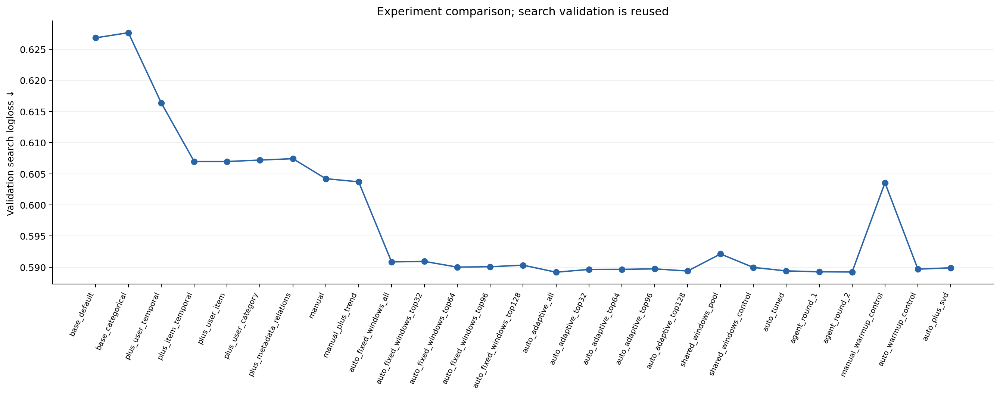

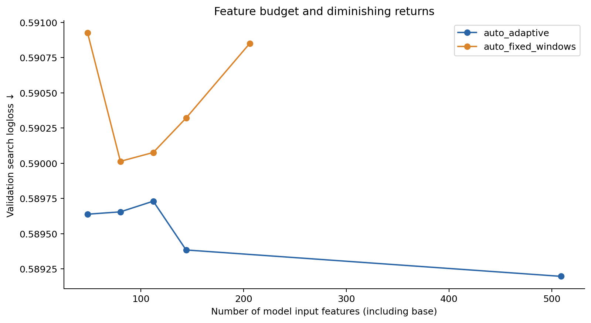

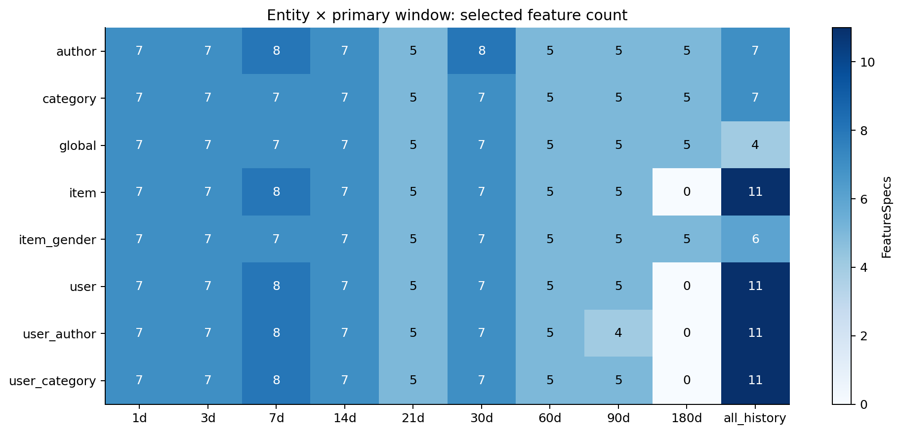

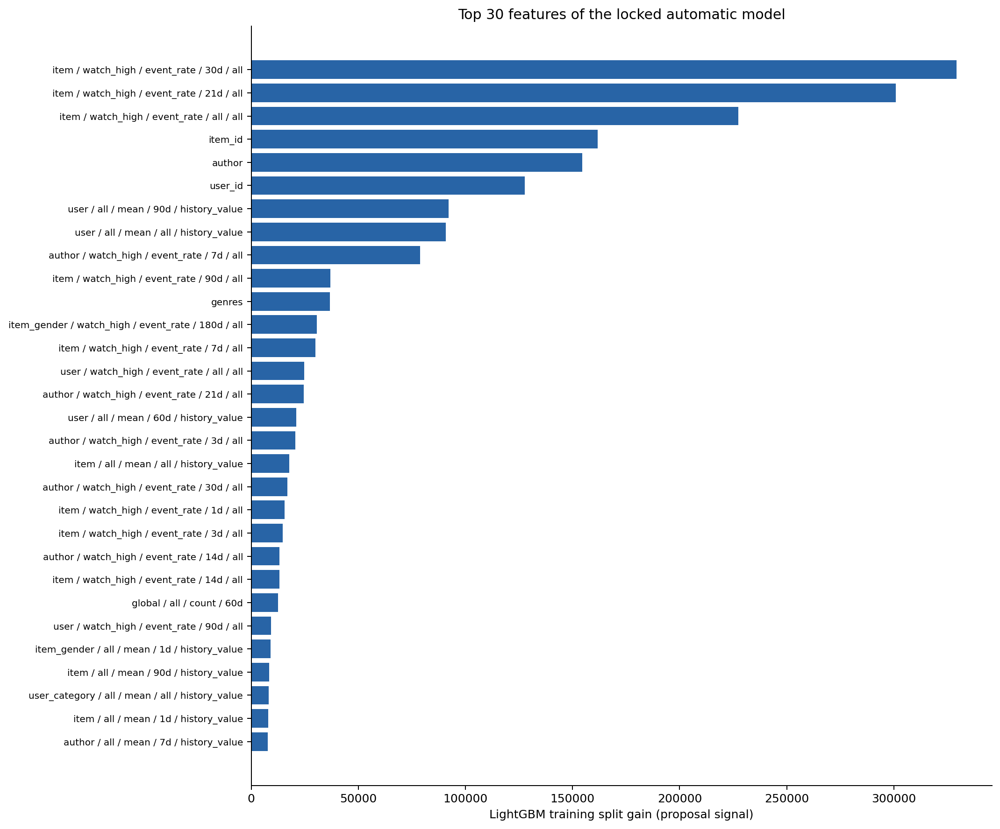

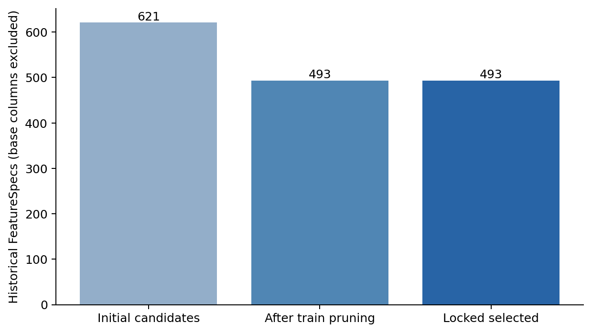

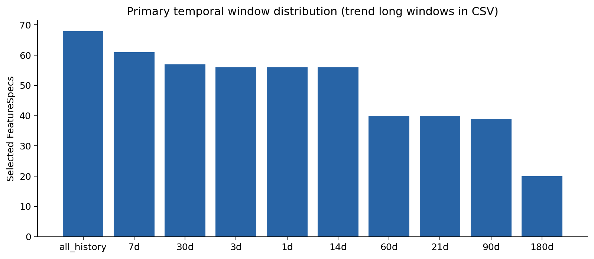

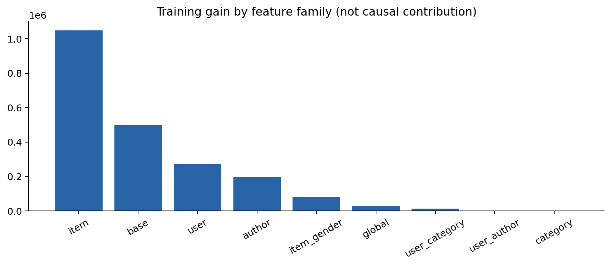

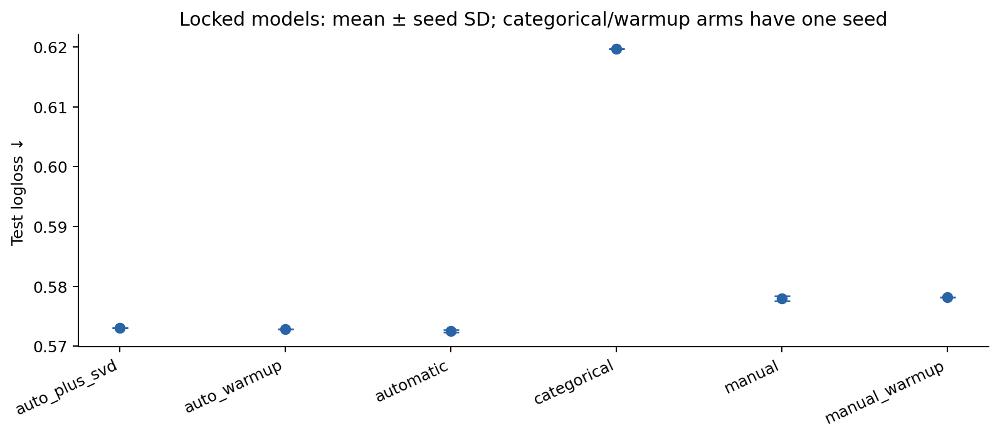

## Yambda-50M explicit-feedback subset

### Данные и target

Фактический размер после нормализации: **989,232 строк**, **8,544 users**, **194,996 items**. Дубликаты по user/item/time/label: 6,654; повторные user–item строки: 50,712.

Target: `like (1) vs dislike (0), conditional on an explicit reaction`. Events: ['like', 'dislike']. Cohort: all likes and dislikes from official flat/50m files; no row sampling.

Время: relative seconds, rounded DOWN to multiples of 5; epoch is an internal coordinate only; no calendar features. category_id: minimum album_id per item; author: minimum artist_id per item.

| Column | Type | Missing |
| --- | --- | --- |
| row_id | UInt32 | 0 |
| user_id | UInt32 | 0 |
| relative_seconds | UInt32 | 0 |
| item_id | UInt32 | 0 |
| is_organic | UInt8 | 0 |
| event | String | 0 |
| label | Int8 | 0 |
| author | String | 0 |
| category_id | String | 0 |
| timestamp | Datetime(time_unit='us', time_zone=None) | 0 |
| time_is_relative | Boolean | 0 |

### Temporal split

| Part | Rows | Start coordinate | End coordinate | Positive rate (test hidden during EDA) |
| --- | --- | --- | --- | --- |
| train | 692462 | 1970-01-01 00:01:15 | 1970-08-25 05:19:25 | 0.885442 |
| validation_search | 74192 | 1970-08-25 05:19:45 | 1970-09-11 08:40:55 | 0.901903 |
| validation_audit | 74193 | 1970-09-11 08:41:20 | 1970-09-28 12:30:25 | 0.906096 |
| test | 148385 | 1970-09-28 12:30:55 | 1970-10-28 22:12:50 | — |

### Baseline, ablation и поиск на validation

Manual: **plus_metadata_relations**; automatic: **auto_adaptive_top32**. HPO: 20 trials для каждого. Candidate specs: 448; после train pruning: 442; selected: 32. Base inputs не входят в selected count.

Completed/attempts HPO: {'manual': {'completed': 20, 'attempts': 20}, 'auto': {'completed': 20, 'attempts': 20}}. Прерванные попытки сохраняются в tuning CSV; budget считает только COMPLETE, чтобы возобновление не сокращало число оцененных конфигураций.

| Model/experiment | Inputs | LogLoss ↓ | AUC ↑ | proxy NDCG@5 | proxy NDCG@10 | proxy Recall@10 | Proxy groups |
| --- | --- | --- | --- | --- | --- | --- | --- |
| base_default | 5 | 0.221252 | 0.856960 | 0.762880 | 0.778507 | 0.959616 | 349 |
| base_categorical | 5 | 0.221622 | 0.855668 | 0.766887 | 0.782466 | 0.962595 | 349 |
| plus_user_temporal | 17 | 0.182502 | 0.909965 | 0.761602 | 0.778591 | 0.962158 | 349 |
| plus_item_temporal | 29 | 0.182344 | 0.911355 | 0.757490 | 0.776891 | 0.961664 | 349 |
| plus_user_item | 41 | 0.175778 | 0.922000 | 0.756963 | 0.772731 | 0.958068 | 349 |
| plus_user_category | 53 | 0.174827 | 0.922967 | 0.777789 | 0.789924 | 0.956756 | 349 |
| plus_metadata_relations | 65 | 0.172084 | 0.925102 | 0.788313 | 0.804319 | 0.970519 | 349 |
| manual | 80 | 0.172390 | 0.923847 | 0.794929 | 0.808820 | 0.964676 | 349 |
| manual_plus_trend | 92 | 0.172374 | 0.923429 | 0.790275 | 0.801763 | 0.961201 | 349 |
| auto_fixed_windows_all | 164 | 0.172463 | 0.923695 | 0.787852 | 0.803940 | 0.965135 | 349 |
| auto_fixed_windows_top32 | 37 | 0.172227 | 0.923670 | 0.806698 | 0.817686 | 0.964114 | 349 |
| auto_fixed_windows_top64 | 69 | 0.172479 | 0.924006 | 0.794159 | 0.809144 | 0.964663 | 349 |
| auto_fixed_windows_top96 | 101 | 0.172818 | 0.923137 | 0.794595 | 0.810220 | 0.965876 | 349 |
| auto_fixed_windows_top128 | 133 | 0.172294 | 0.924198 | 0.797108 | 0.812199 | 0.962496 | 349 |
| auto_adaptive_all | 447 | 0.172681 | 0.923413 | 0.796864 | 0.810095 | 0.963825 | 349 |
| auto_adaptive_top32 | 37 | 0.171809 | 0.924655 | 0.799382 | 0.812859 | 0.960325 | 349 |
| auto_adaptive_top64 | 69 | 0.172348 | 0.923739 | 0.803977 | 0.815772 | 0.964318 | 349 |
| auto_adaptive_top96 | 101 | 0.172251 | 0.923989 | 0.794584 | 0.810027 | 0.964366 | 349 |
| auto_adaptive_top128 | 133 | 0.172263 | 0.923764 | 0.798870 | 0.813338 | 0.962357 | 349 |
| shared_windows_pool | 162 | 0.173411 | 0.923730 | 0.792434 | 0.806203 | 0.964169 | 349 |
| shared_windows_control | 37 | 0.173403 | 0.923560 | 0.796268 | 0.811959 | 0.966427 | 349 |
| auto_tuned | 37 | 0.171926 | 0.924517 | 0.796093 | 0.809512 | 0.962965 | 349 |
| agent_round_1 | 45 | 0.172262 | 0.923547 | 0.805657 | 0.814771 | 0.959339 | 349 |
| agent_round_2 | 45 | 0.171764 | 0.924090 | 0.797335 | 0.810490 | 0.963984 | 349 |
| manual_warmup_control | 65 | 0.173919 | 0.923879 | 0.800854 | 0.811616 | 0.958957 | 349 |
| auto_warmup_control | 37 | 0.172992 | 0.922861 | 0.804936 | 0.816151 | 0.958675 | 349 |
| auto_plus_svd | 41 | 0.173726 | 0.921821 | 0.789538 | 0.803372 | 0.961156 | 349 |

В последовательной ablation rates добавляются после metadata relations. Все ablation arms используют одни manual tuned параметры; вклад группы условен на уже добавленных предыдущих группах. Fixed/shared controls сначала ограничивают допустимый pool, затем независимо выполняют train pruning и fit; shared ranking использует gain собственного pool. Controls меняют состав и размер набора; это не чистый причинный эффект одного окна.

### Audit и финальный test

| Model/experiment | Inputs | LogLoss ↓ | AUC ↑ | proxy NDCG@5 | proxy NDCG@10 | proxy Recall@10 | Proxy groups |
| --- | --- | --- | --- | --- | --- | --- | --- |
| categorical | 5 | 0.234879 | 0.812967 | 0.781923 | 0.795565 | 0.975163 | 366 |
| manual | 65 | 0.169444 | 0.923237 | 0.798123 | 0.811031 | 0.974188 | 366 |
| automatic | 37 | 0.170887 | 0.920931 | 0.796985 | 0.808747 | 0.979720 | 366 |
| manual_warmup | 65 | 0.169206 | 0.923251 | 0.796812 | 0.808100 | 0.973602 | 366 |
| auto_warmup | 37 | 0.171657 | 0.920112 | 0.792021 | 0.806638 | 0.977128 | 366 |
| auto_plus_svd | 41 | 0.172348 | 0.919043 | 0.790227 | 0.803461 | 0.978368 | 366 |
| auto_fixed_windows_top32 | 37 | 0.171955 | 0.920205 | 0.797615 | 0.811035 | 0.976466 | 366 |
| auto_adaptive_top32 | 37 | 0.170887 | 0.920931 | 0.796985 | 0.808747 | 0.979720 | 366 |
| shared_windows_control | 37 | 0.171053 | 0.921135 | 0.799237 | 0.814517 | 0.979771 | 366 |

| Model/experiment | Inputs | LogLoss ↓ | AUC ↑ | proxy NDCG@5 | proxy NDCG@10 | proxy Recall@10 | Proxy groups |
| --- | --- | --- | --- | --- | --- | --- | --- |
| categorical | 5 | 0.234020 | 0.833212 | 0.763002 | 0.779924 | 0.966758 | 758 |
| manual | 65 | 0.163386 | 0.935777 | 0.795200 | 0.811674 | 0.969548 | 758 |
| automatic | 37 | 0.160846 | 0.937087 | 0.788233 | 0.804600 | 0.969801 | 758 |
| manual_warmup | 65 | 0.163300 | 0.936390 | 0.788485 | 0.802994 | 0.969447 | 758 |
| auto_warmup | 37 | 0.160898 | 0.936878 | 0.788279 | 0.804188 | 0.968434 | 758 |
| auto_plus_svd | 41 | 0.161202 | 0.936640 | 0.787469 | 0.800673 | 0.968864 | 758 |

Среднее/SD на test между заранее заданными seeds (SVD arms — один seed):

| Model | Seeds | Mean LogLoss | SD LogLoss | Mean AUC | SD AUC |
| --- | --- | --- | --- | --- | --- |
| auto_plus_svd | 1 | 0.161202 | — | 0.936640 | — |
| auto_warmup | 1 | 0.160898 | — | 0.936878 | — |
| automatic | 3 | 0.161150 | 0.000440 | 0.936790 | 0.000331 |
| categorical | 1 | 0.234020 | — | 0.833212 | — |
| manual | 3 | 0.163072 | 0.000446 | 0.936045 | 0.000243 |
| manual_warmup | 1 | 0.163300 | — | 0.936390 | — |

Automatic − manual: mean ΔLogLoss **-0.001921**; paired ΔLogLoss seed 42 **-0.002540**, 95% user-cluster CI **[-0.004236, -0.000928]**. ΔAUC seed 42 +0.001310. Bootstrap 300 repeats, фиксированные модели. Неопределенность всей процедуры search этим CI не покрывается.

**Автоматический набор улучшил LogLoss на этом test: среднее по seeds меньше, а paired CI для заранее выбранного seed 42 ниже нуля.**

### Selected temporal windows

| Entity | Selected specs | Windows including trend dependencies |
| --- | --- | --- |
| user | 21 | 1d, 3d, 7d, 14d, 21d, 30d, 60d, 90d, 180d, all_history |
| user_author | 5 | 60d, 90d, 180d, all_history |
| user_item | 6 | 180d, all_history |

Explicit trend specs в выбранном наборе: 0. Наличие разных окон не доказывает их необходимость; сравнение shared_windows_control на audit важнее одного heatmap.

### Feature agent и pruning

| Round | Before | After | KEEP | Generation s |
| --- | --- | --- | --- | --- |
| 1 | 0.171809 | 0.172262 | False | 0.736954 |
| 2 | 0.171809 | 0.171764 | False | 0.568737 |

Pruning log содержит 6 удалений. Все proposals и причины сохранены отдельно; rejected proposals не включаются в locked набор.

### Feature importance

| Feature | Train gain | Family |
| --- | --- | --- |
| user__like__event_rate__60d__all | 418553.170343 | user |
| user_id | 227075.558090 | base |
| user__like__event_rate__14d__all | 150871.078327 | user |
| user__like__event_rate__30d__all | 134823.580458 | user |
| user__like__event_rate__21d__all | 127702.261101 | user |
| user__like__event_rate__180d__all | 123927.144327 | user |
| user__like__event_rate__90d__all | 89903.234039 | user |
| user__like__event_rate__all__all | 68357.696674 | user |
| user__like__event_rate__1d__all | 67999.531822 | user |
| user__dislike__recency__all | 63292.875254 | user |
| user__like__event_rate__7d__all | 58599.877716 | user |
| user__like__event_rate__3d__all | 36649.477318 | user |
| author | 33317.900211 | base |
| user_item__all__recency__all | 26821.536621 | user_item |
| category_id | 25341.699577 | base |
| item_id | 21457.794357 | base |
| user__like__recency__all | 18194.048332 | user |
| user_item__like__recency__all | 13354.297562 | user_item |
| user__all__recency__all | 11000.461735 | user |
| user_author__like__event_rate__all__all | 10608.224213 | user_author |

Gain — train-only proposal signal со смещением при корреляции; не причинная importance. SHAP и permutation importance не вычислялись, такие результаты не заявляются.

Выбранный Yambda набор в основном состоит из user histories; item/category families в top32 не попали. Это согласуется с доминированием склонности пользователя выражать like/dislike в данной conditional задаче — интерпретация по составу features, а не доказанная причина. Высокий AUC поэтому нельзя трактовать как умение выбрать лучший следующий трек из каталога.

### Learned representations

SVD basis fit-ится на первых 10% событий. Их строки исключены одинаково в manual_warmup/auto_warmup/auto_plus_svd. User profile — mean signed item vectors по строгому прошлому. Unknown basis items имеют нулевой vector. Этот эксперимент не использует будущие train edges.

SVD − auto_warmup ΔLogLoss **+0.000304**, CI **[-0.000110, +0.000696]**; ΔAUC -0.000237. Один seed; conditional CI. Manual+SVD не обучался, весь возможный выигрыш hybrid нельзя приписать именно auto search.

### Ответы на исследовательские вопросы

Manual multi-scale trends меняют search LogLoss на -0.000017; это небольшой условный эффект, а не универсальная польза ratios. Итоговый automatic набор содержит 0 explicit trend specs.

Начальный pruning: 448 → 442. Всего исследовано 464 specs с учетом agent proposals, в финале 32, на 93.1% меньше total explored. До HPO/agent выбранный adaptive budget против adaptive_all дает Δ search LogLoss -0.000872 при одинаковых initial parameters. Curve по budgets показывает фактическую зависимость качества от числа inputs; компактный оптимум заранее не предполагается.

Adaptive_all − fixed-window pool: Δ search LogLoss +0.000218; отрицательная разница означает преимущество adaptive в этом сравнении. На audit выбранный adaptive набор − shared-window control: Δ LogLoss -0.000166. Знак результата сохранен; более гибкое пространство не обязано выигрывать. Состав features и процедура отбора тоже различаются; отдельный причинный эффект индивидуальных окон не изолирован.

Расчет manual плюс всех дополнительных кандидатов занимает примерно 2.05× manual generation. Это только feature computation, без дополнительных fitting/search rounds. Итоговый serving использует выбранные specs, а не весь исследованный pool.

Человек перестал выбирать каждую конкретную колонку и окно; он по-прежнему задает target, допустимые отношения, primitives, temporal protocol и budget. Agent принял 0 из 2 групп по search threshold. Автоматизация процесса и доказанный вклад каждой его стадии — разные утверждения.

### Вычислительная стоимость

Измеренная сумма fit time стадии manual (seed42 ablations + HPO): **200.8 s**; дополнительной auto search стадии (pool/budget/agent/shared fits + HPO): **308.6 s**, **1.54×** manual стадии сверх нее. HPO отдельно: manual 108.5 s, auto 110.1 s. Здесь нет prediction/metrics overhead, feature generation, representations, дополнительных seeds и final refits; это не elapsed wall time.

Manual + manual trends generation: **16.015 s**, matrix 283.8 MiB; дополнительные auto candidates: **16.838 s**, matrix 1162.0 MiB. Final selected features на всех строках: 17.675 s.

| Experiment | Inputs | Fit s | Peak process MiB |
| --- | --- | --- | --- |
| base_default | 5 | 21.410318 | 1208.265625 |
| base_categorical | 5 | 12.634089 | 1763.312500 |
| plus_user_temporal | 17 | 5.429979 | 1695.718750 |
| plus_item_temporal | 29 | 7.349598 | 1779.468750 |
| plus_user_item | 41 | 7.743923 | 1625.125000 |
| plus_user_category | 53 | 7.952649 | 1795.296875 |
| plus_metadata_relations | 65 | 10.044499 | 1990.421875 |
| manual | 80 | 10.555170 | 2276.703125 |
| manual_plus_trend | 92 | 9.150726 | 2637.578125 |
| auto_fixed_windows_all | 164 | 16.346930 | 4362.062500 |
| auto_fixed_windows_top32 | 37 | 7.565045 | 4036.984375 |
| auto_fixed_windows_top64 | 69 | 9.280443 | 4178.703125 |
| auto_fixed_windows_top96 | 101 | 11.095940 | 4243.265625 |
| auto_fixed_windows_top128 | 133 | 14.512443 | 3033.546875 |
| auto_adaptive_all | 447 | 28.912328 | 5745.484375 |
| auto_adaptive_top32 | 37 | 8.097271 | 4322.109375 |
| auto_adaptive_top64 | 69 | 17.089100 | 3130.859375 |
| auto_adaptive_top96 | 101 | 16.917273 | 1626.078125 |
| auto_adaptive_top128 | 133 | 16.933493 | 2169.250000 |
| shared_windows_pool | 162 | 16.371780 | 2698.468750 |
| shared_windows_control | 37 | 11.500642 | 1261.875000 |
| auto_tuned | 37 | 9.102323 | 1016.890625 |
| agent_round_1 | 45 | 7.413385 | 1416.546875 |
| agent_round_2 | 45 | 7.319807 | 1525.468750 |
| manual_warmup_control | 65 | 7.684185 | 2067.593750 |
| auto_warmup_control | 37 | 6.775540 | 1595.140625 |
| auto_plus_svd | 41 | 6.758956 | 1574.953125 |

RSS — peak процесса с удерживаемыми матрицами. Generation=0/cache_hit=True означает reuse, но cache_hit в model rows не является точной трассировкой происхождения каждого block. Профили cache сохраняют измеренное время создания matrix; в повторном KION оно относится к предыдущему вычислению с тем же engine/data/spec hash. HPO time хранится отдельно в tuning CSV; указанные fit times не являются end-to-end latency.

Post-lock diagnostics: known/unknown IDs и organic/recommendation-driven, где доступны. Они не используются для смены модели.

| Model | Segment | Rows | LogLoss | AUC |
| --- | --- | --- | --- | --- |
| categorical | known_user_id | 134945 | 0.221662 | 0.851885 |
| categorical | unknown_user_id | 13440 | 0.358100 | 0.557442 |
| categorical | recommendation_driven | 62337 | 0.224633 | 0.854850 |
| categorical | organic | 86048 | 0.240820 | 0.816362 |
| manual | known_user_id | 134945 | 0.157256 | 0.938866 |
| manual | unknown_user_id | 13440 | 0.224937 | 0.901957 |
| manual | recommendation_driven | 62337 | 0.161892 | 0.938858 |
| manual | organic | 86048 | 0.164468 | 0.933422 |
| automatic | known_user_id | 134945 | 0.155157 | 0.939796 |
| automatic | unknown_user_id | 13440 | 0.217960 | 0.907384 |
| automatic | recommendation_driven | 62337 | 0.159807 | 0.939648 |
| automatic | organic | 86048 | 0.161599 | 0.935109 |
| manual_warmup | known_user_id | 134945 | 0.157355 | 0.939440 |
| manual_warmup | unknown_user_id | 13440 | 0.222998 | 0.903270 |
| manual_warmup | recommendation_driven | 62337 | 0.162232 | 0.938824 |
| manual_warmup | organic | 86048 | 0.164074 | 0.934528 |
| auto_warmup | known_user_id | 134945 | 0.155365 | 0.939512 |
| auto_warmup | unknown_user_id | 13440 | 0.216447 | 0.907318 |
| auto_warmup | recommendation_driven | 62337 | 0.160116 | 0.939390 |
| auto_warmup | organic | 86048 | 0.161464 | 0.934955 |
| auto_plus_svd | known_user_id | 134945 | 0.155570 | 0.939300 |
| auto_plus_svd | unknown_user_id | 13440 | 0.217755 | 0.907068 |
| auto_plus_svd | recommendation_driven | 62337 | 0.160211 | 0.938872 |
| auto_plus_svd | organic | 86048 | 0.161920 | 0.934899 |

### Графики

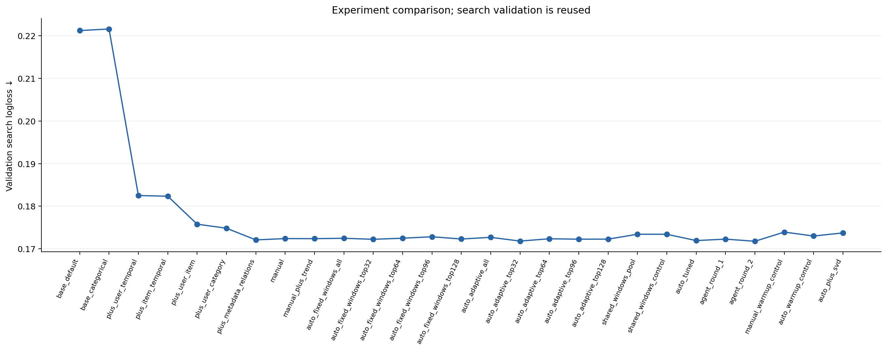

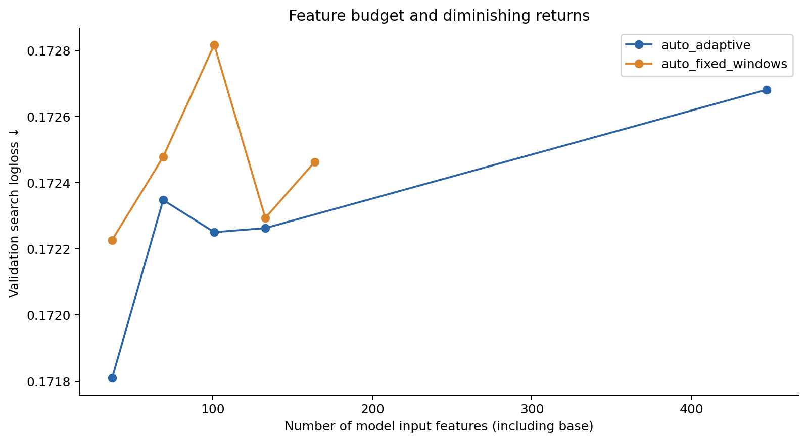

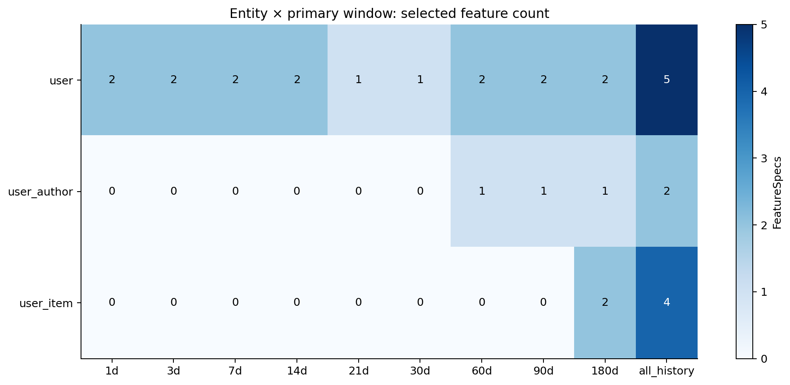

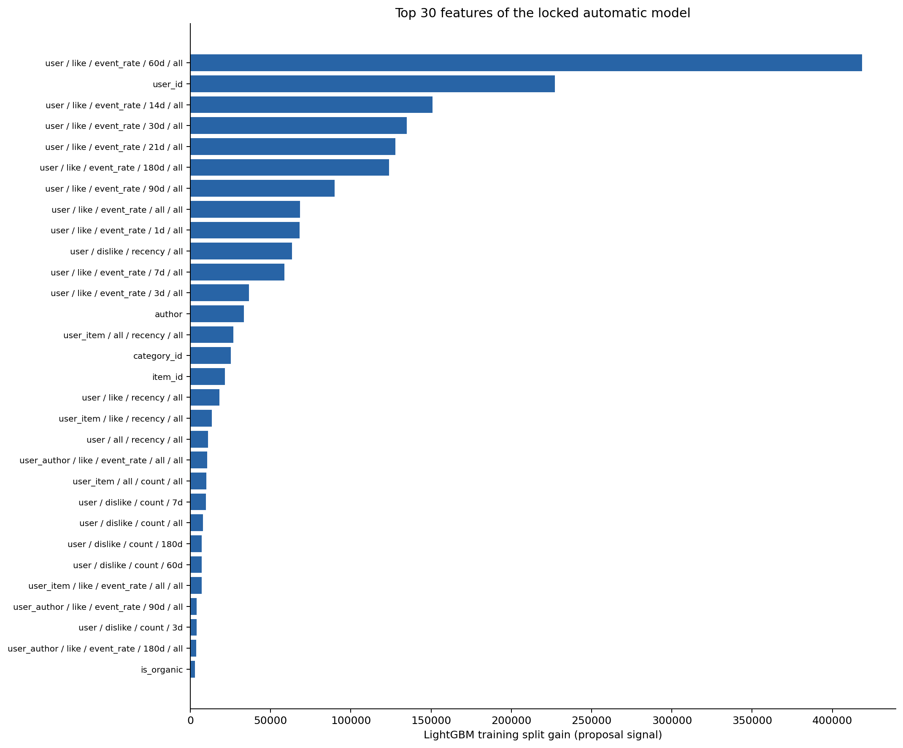

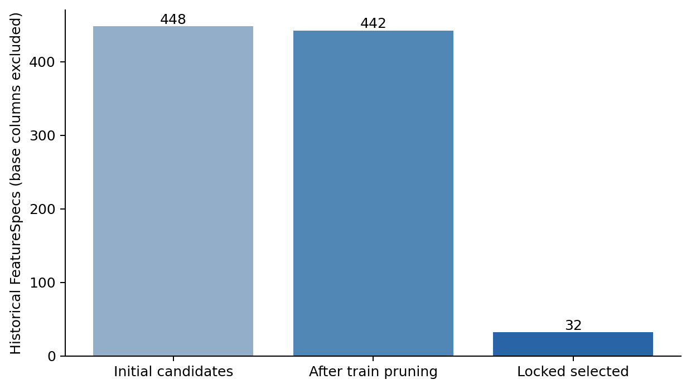

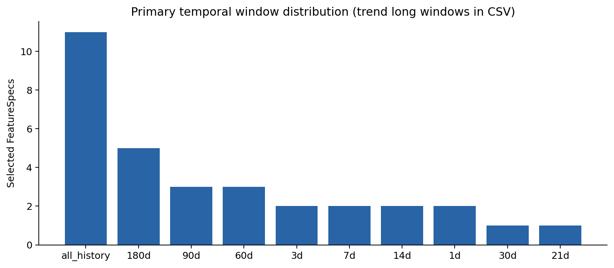

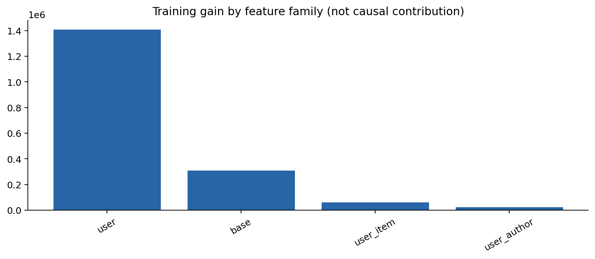

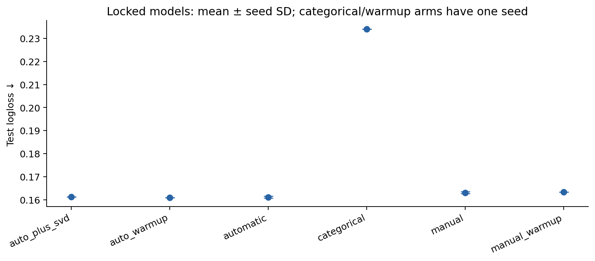

## Ограничения, production scalability и conclusions

Выбор отдельных features/windows автоматизирован, но target, availability assumptions,
schema relations, grammar и budget остаются решениями исследователя. Качество auto
оценивается отдельно на каждом dataset, отрицательные или неубедительные итоги сохраняются.
Небольшие изменения search validation сами по себе не доказывают перенос на test.
Агрегированный KION и action-conditioned Yambda не заменяют impression-log validation.
Нужны несколько rolling-origin splits и независимый production evaluation.

Все показанные значения вычислены реальными runs; timings не симулировались. Графики,
selected windows и agent trace сохранены отдельно по dataset. Learned SVD — дополнительный
controlled эксперимент, а не автоматическое доказательство преимущества feature search.

Локально обработаны 1.59M и 0.99M событий. 1B+ здесь не запускался: dense O(NF) matrix
не подходит для такого масштаба. Нужны entity-sharded state, streaming counters,
point-in-time feature store, partitioned offline ETL, shared primitive cache, bounded
search на выборке и serving только выбранных specs. Exact rolling distinct/min/max
имеют разные costs; late arrivals требуют watermark/retractions/backfill. GNN требуют
distributed graph sampling, Transformers — bounded sequences, distributed training,
embedding tables и serving. Для 100B events понадобится отдельная инфраструктура.

Future work: добавить полный listen/unlike/undislike context Yambda с отдельными
query/history tables, настоящий candidate-generation/ranking benchmark, versioned metadata,
label availability timestamps, cost-aware search, permutation importance, decayed counters,
несколько safe representation snapshots и rolling-origin evaluation. Official benchmark
MAP/Recall в этом отчете не присваиваются нашему scoring pipeline.
